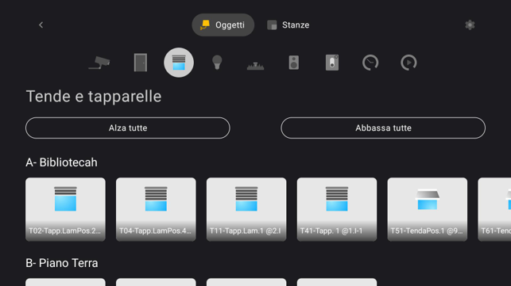
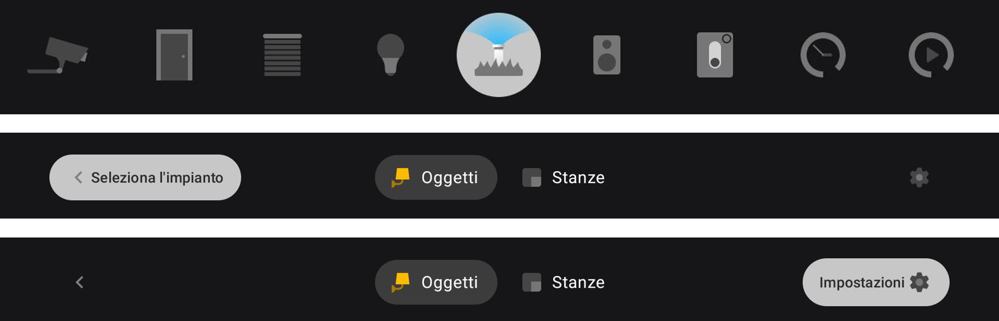
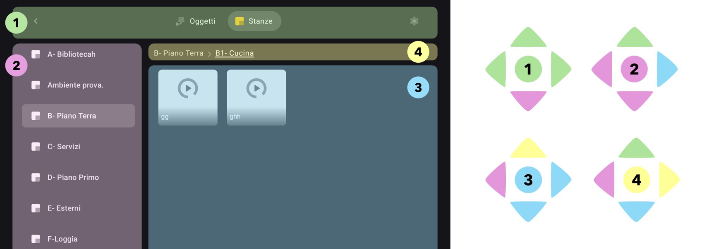
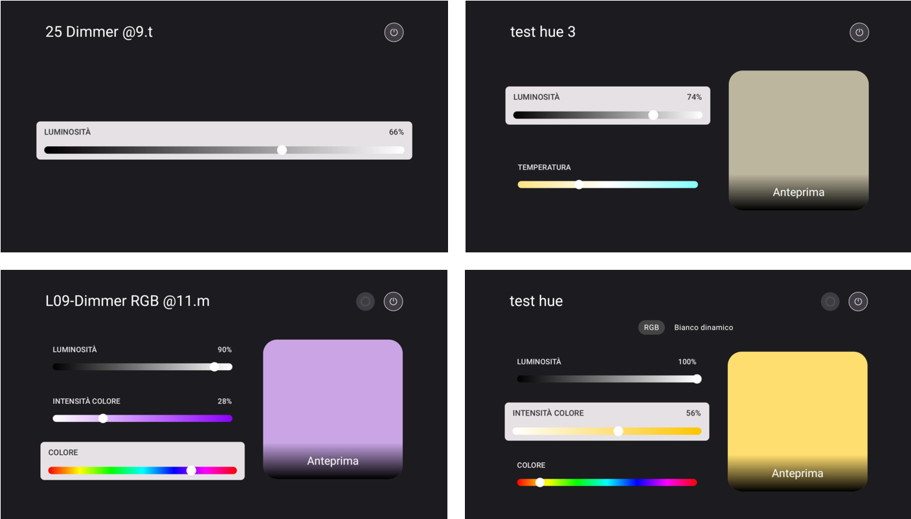
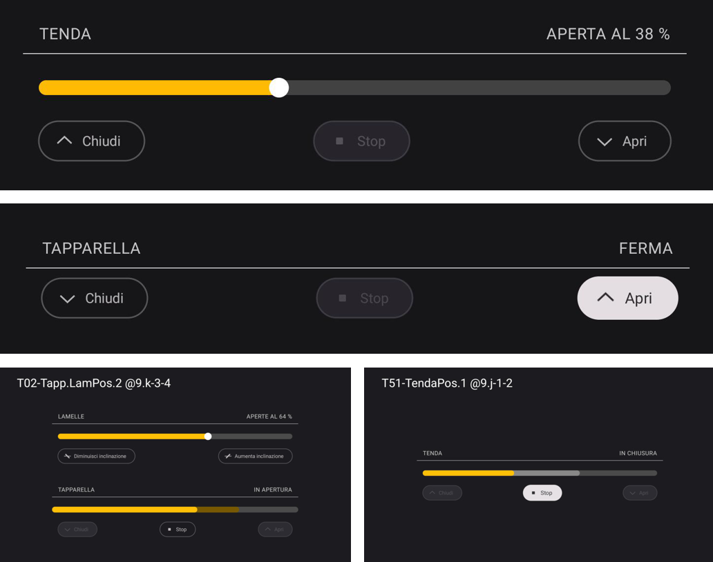
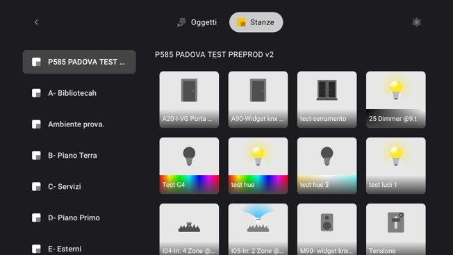
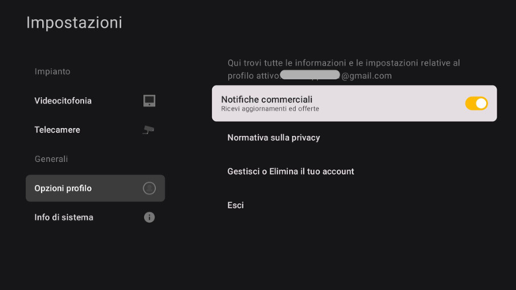
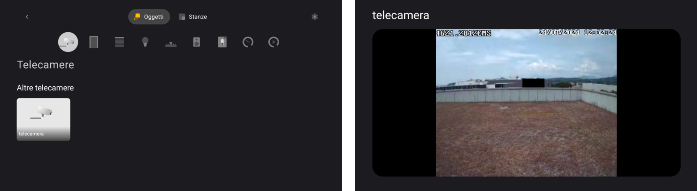
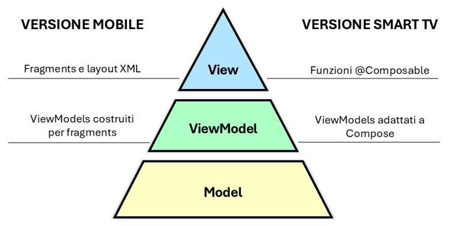

# Vimar VIEW for Android TV
### Smart Home Control Application | Kotlin & Jetpack Compose

*Bringing smart home control from your phone to your living room.*

What if you could manage your home's lights, shutters, cameras, and connected devices directly from your TV, without reaching for your phone?

During my internship at **Vimar S.p.A.**, I designed and developed an Android TV prototype of **Vimar VIEW**, the company's existing smart home management application.

The goal was to explore the feasibility of extending the mobile experience to Smart TVs, adapting both the interface and interactions to a larger screen and remote-control navigation, while integrating with the existing home automation system.

The project was developed within Vimar's R&D department in Padua, Italy, over approximately **350 hours between May and July 2024**, as part of my Bachelor's degree in Computer Engineering at the University of Padua.

> **Portfolio showcase — Source code not available**
>
> This repository documents my work through screenshots and technical explanations. The application was developed within Vimar's proprietary software ecosystem, and its source code cannot be publicly shared due to company confidentiality and intellectual property restrictions.

## From Mobile to TV

The main challenge was not simply displaying the mobile application on a larger screen, but **rethinking how users interact with it**.

Unlike smartphones, Android TVs rely primarily on directional remote controls. This makes focus management, component placement, readability, and navigation efficiency especially important.

I explored different navigation layouts before designing an interface built around two horizontal navigation levels: a main menu for switching between sections and a compact, icon-based menu for browsing device categories.

Moving the focus between categories immediately updates the displayed devices, reducing the number of remote-control clicks required. Buttons also expand or change appearance when focused, making navigation easier to follow from a distance.

The resulting interface preserves the visual identity and familiar organisation of Vimar VIEW while introducing interactions designed specifically for TV.

### Remote-Control Focus Management

One of the main challenges was designing predictable navigation across multiple interface regions using only the TV remote's directional buttons.

I organised the interface into distinct focus areas, including the main navigation bar, room selection, device cards, and the current room hierarchy. I then defined how focus should move between these areas to prevent unexpected jumps and make navigation more intuitive.

## Features & Interactions

The prototype connects to existing Vimar smart home installations, allowing users to browse connected devices, issue commands, and monitor their current states.

### Lighting Control

The application supports different types of lights, from simple on/off switches to dimmable and RGB lighting.

Depending on the device, users can adjust brightness, colour temperature, and colour through dedicated detail panels.

I developed reusable **custom slider components in Jetpack Compose**, combining Canvas-based rendering with remote-control input handling and reactive device-state updates.

### Curtains & Shutters

Curtains and shutters required a different interaction approach from the mobile application.

I redesigned their controls around horizontal adjustment bars and clearly separated action buttons, supporting different device capabilities, including position control and adjustable slats.

One particularly interesting challenge involved how commands were sent to the physical devices.

Initially, every movement along the slider triggered an immediate command to the gateway. Unlike lighting commands, these updates were not delayed, making the control difficult to use and generating unnecessary requests.

I solved this by **separating the temporary slider position from the actual device value**. Users can freely adjust the target position with the remote, while the command is sent when they release the directional button. At the same time, the UI remains responsive to external device-state changes.

This improved usability without requiring changes to the existing device communication logic.

### Device Browsing & Account Management

Users can browse devices either by category or by room, switch between existing smart home installations, and access account and system settings.

The application includes an authentication flow through the TV browser, installation selection, account logout, and dedicated settings screens.

The settings interface also provides access to profile management,
system information, camera configuration, and video intercom settings.

### IP Cameras & Video Intercom

I also worked on integrating video-based devices into the TV experience.

For **IP cameras**, I implemented a configuration flow for registering cameras locally and a dedicated screen for viewing their live video streams.

The **video intercom** functionality involved SIP authentication, call-related settings, and a dedicated incoming-call interface. During testing, however, the TV hardware could not reliably decode the video stream produced by the existing intercom system.

Rather than modifying the shared proprietary video infrastructure for an experimental TV application, this limitation was documented and further development of the feature was suspended.

This was an important part of the feasibility assessment: understanding not only what could be implemented, but also where hardware and integration constraints affected the result.

## Technical Implementation

The application was developed in **Kotlin using Android Studio**, with **Jetpack Compose for TV** and Material Design principles guiding the interface.

The project followed the existing application's **MVVM and Clean Architecture** approach, separating UI, presentation logic, and device communication.

A key objective was to evaluate how much of the mobile application's underlying functionality could be reused while keeping the two applications independent.

To support this, I reused existing data-management logic in a separate TV project and adapted the ViewModels to the new Compose-based interface and navigation model. This allowed me to focus on TV-specific behaviour without introducing changes to the mobile application.

The main technical areas I worked on included:

- **Reactive UI:** Keeping device controls and displayed values synchronised with real device states.
- **Focus-based navigation:** Designing remote-friendly navigation flows and visual feedback for selected elements.
- **Reusable Compose components:** Building adaptable controls for different device types and capabilities.
- **State and command handling:** Separating temporary UI input from device commands where necessary.
- **Integration and testing:** Working with existing application modules, proprietary communication libraries, and real smart home devices.

## Development & Results

This was an individual development project carried out within Vimar's Android development team. 
I was involved in the team's Agile/Scrum workflow, attending daily stand-ups and following the development and review process while working on the TV prototype.

My work covered the full prototype development cycle: studying Android TV guidelines, exploring interface alternatives, designing and implementing the UI, integrating existing application functionality, debugging, and demonstrating the result.

The prototype was tested on Android TV hardware and with a functioning home automation installation.

The final result demonstrated the feasibility of controlling smart home devices through a TV interface, particularly for lighting, shutters, room navigation, and camera viewing.
It also highlighted important constraints, including differences in TV hardware performance, remote-control usability, and video decoding compatibility.

The project remained a **feasibility prototype**, rather than a commercially released application.

## Tools & Technologies

- **Language:** Kotlin
- **Platform:** Android TV
- **UI:** Jetpack Compose for TV, Material Design 3
- **Architecture:** MVVM, Clean Architecture
- **Development:** Android Studio, Git, Bitbucket
- **Workflow:** Agile/Scrum
- **Integration:** Existing Vimar smart home communication modules and SIP-related libraries

## About This Repository

This is a documentation-only portfolio repository.

The original application source code, proprietary libraries, internal project files, and deployment artifacts are not included due to company confidentiality and intellectual property restrictions. The screenshots and technical explanations are intended to showcase my work and the challenges addressed during development.

The project was developed during my internship at **Vimar S.p.A.** and documented in my Bachelor's thesis in Computer Engineering at the **University of Padua (2024)**. 
The full thesis, *Design and Development of an Android TV Application for Smart Home Device Control*, is publicly available in the University's official thesis archive:

**[Read the full Bachelor's thesis — University of Padua](https://thesis.unipd.it/handle/20.500.12608/76476)**